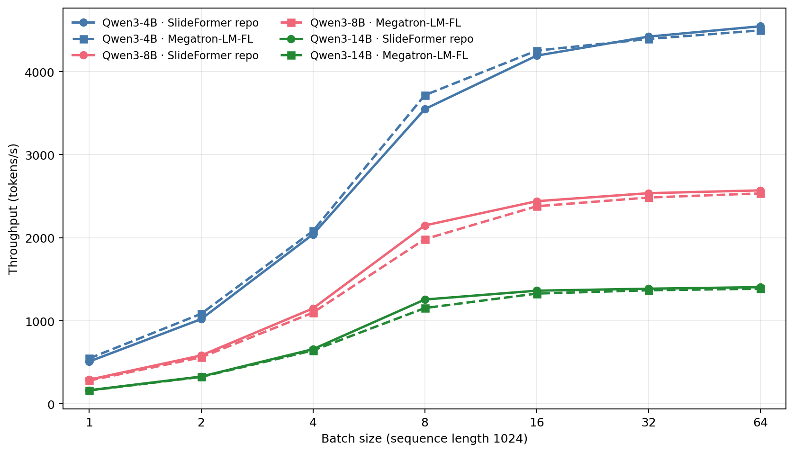
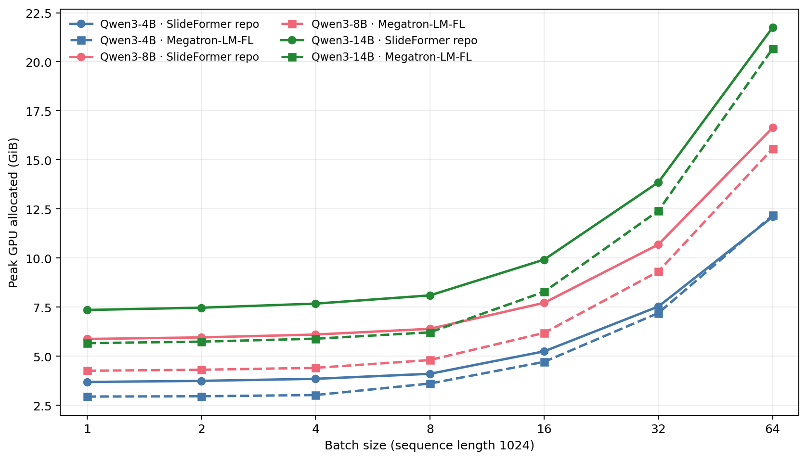
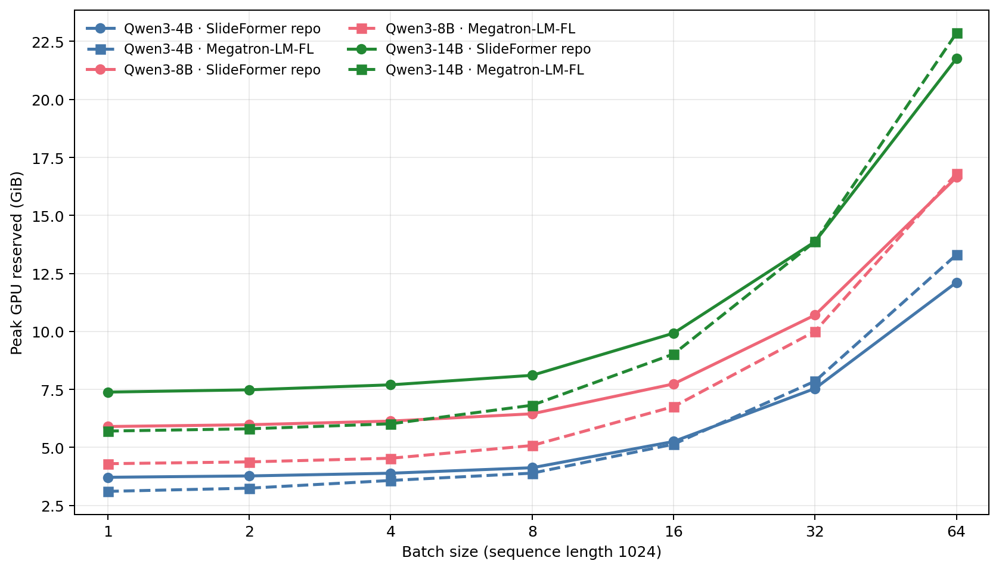
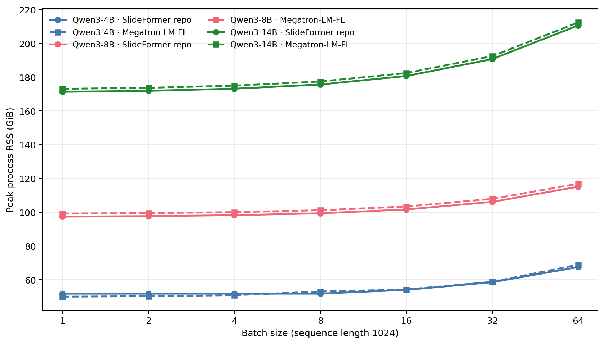

<!-- Copyright (c) 2026 NVIDIA CORPORATION & AFFILIATES. All rights reserved. -->

# SlideFormer for Megatron-LM-FL

## Summary

The layer-sliding engine supports single- and multi-GPU full-parameter
fine-tuning through the same Megatron-LM-FL training entry point. The
implementation keeps the FP32 master weights and Adam state on CPU, streams
a bounded window of layers to the GPU, and overlaps H2D parameters, GPU
compute, D2H gradients and CPU updates. Megatron owns model construction,
parallelism and scheduling. The optional Dense DP transport draws on
[SlideDP](https://arxiv.org/abs/2609.34162).

Historical performance runs below identify their hardware, inputs, measured
steps and source revision. The single-GPU sweep is available as
[CSV](images/slideformer/qwen3_scaling_pr_head.csv).

## Single- and multi-GPU quick start

The plugin is opt-in. It uses Megatron's model and Transformer Engine operators
with `MEGATRON_SLIDEFORMER_KERNEL_POLICY=off`. Activate the CUDA environment
used for Megatron-LM-FL and make a C++17 compiler, pybind11 and Ninja available for
building the CPU Adam extension. Use idle GPU IDs and a fresh checkpoint path.

```bash
# Single GPU
MEGATRON_SLIDEFORMER_KERNEL_POLICY=off SLIDEFORMER_GPU_IDS=0 GLOBAL_BATCH=1 \
  bash tests/functional_tests/slideformer/run_smoke.sh --attention-backend unfused

# Two GPUs, native dense data parallelism with the sharded transport preset
MEGATRON_SLIDEFORMER_KERNEL_POLICY=off SLIDEFORMER_GPU_IDS=0,1 \
  GLOBAL_BATCH=2 PER_TOKEN=1 MEGATRON_SLIDEFORMER_DP_PRESET=dense-dp \
  bash tests/functional_tests/slideformer/run_smoke.sh --attention-backend unfused
```

The smoke runner uses synthetic data. For training on real data, use the
same Megatron-LM-FL launch and arguments you use for your model and dataset,
with `--clip-grad 0`. Use these environment variables before launching:

| Setting | Effect |
| --- | --- |
| `MEGATRON_SLIDEFORMER_ENABLE=1` | Enable the layer-sliding engine for the training job. |
| `MEGATRON_SLIDEFORMER_ACTIVATION_OFFLOAD=1` | Enable activation offload for the default `slideformer-slot` backend. |
| `MEGATRON_SLIDEFORMER_KERNEL_POLICY=off` | Use the model's native operator choices. |
| `MEGATRON_SLIDEFORMER_DP_PRESET=dense-dp` | Enable sharded H2D and native GPU reduction for same-host dense DP. Set BF16, native per-token loss and one microbatch per optimizer update. |
| `MEGATRON_SLIDEFORMER_ENABLE=0` | Run the default Megatron path. |

For TP, CP or MoE/EP training, use the appropriate native Megatron groups
and leave the Dense DP preset unset. The script defaults to the in-tree engine.
The [wheel guide](../slideformer_package.md) describes installation and the
`FullFineTuneSession` lifecycle for custom MCore trainers.

### Resume a run

The engine stores its own weights, FP32 master parameters, active Adam state
and RNG. Keep the same model, checkpoint backend and parallel topology.
Use the standard `--save` and `--load` flags in your training job. The smoke
runner exposes the same arguments through `CHECKPOINT_DIR` and `LOAD_DIR`.

```bash
export SLIDEFORMER_GPU_IDS=0 GLOBAL_BATCH=1 MEGATRON_SLIDEFORMER_KERNEL_POLICY=off
export SLIDE_CKPT=$(mktemp -d)
TRAIN_ITERS=10 SAVE_INTERVAL=10 CHECKPOINT_DIR="$SLIDE_CKPT" \
  bash tests/functional_tests/slideformer/run_smoke.sh --attention-backend unfused --lr-decay-iters 15
TRAIN_ITERS=15 LOAD_DIR="$SLIDE_CKPT" \
  bash tests/functional_tests/slideformer/run_smoke.sh --attention-backend unfused --lr-decay-iters 15
```

The second process resumes at step 10 and trains to step 15. Keep the
learning-rate schedule consistent when comparing against a continuous run. For a per-step loss
comparison, give each launch its own `--tensorboard-dir` and set
`--tensorboard-log-interval 1`. Compare the `lm loss` scalars by step.
Megatron stdout reports interval averages and retains the first iteration
in the next logging interval.

### Multi-GPU integration

Megatron still constructs the model, partitions TP parameters, and runs the
forward/backward schedule. Its TP gradient classification and global token
normalization are shared with the Slide path. PP tied/conditional embedding
reductions use the native Megatron collectives; the adapter exposes the actual
accumulated gradients and orders CUDA streams around those collectives.

`MEGATRON_SLIDEFORMER_GPU_GRADIENT_PIPELINE` now defaults to `0`: the sliding
path must not allocate full-model FP32 gradients on each GPU. The full GPU
accumulator remains an explicit, memory-budgeted diagnostic alternative.

Same-host DP/CP replicas can enable `MEGATRON_SLIDEFORMER_SHARDED_CPU_OPT=1`.
Each rank owns only its slice of Adam moments. LayerAdam and the sharded worker
reference the same buffers, and checkpoints serialize those active moments.
Full-model moment buffers and their parameter views are released when ownership
transfers to the shard. Checkpoint restore requires identical parallel topology;
old sharded checkpoints without shard metadata are rejected because they saved
inactive optimizer state. Unsharded legacy checkpoints remain loadable.

The existing rank/chunk Slide checkpoint container remains in use. Native
Megatron distributed checkpoint resharding is not yet supported. PP uses the
unsharded optimizer fallback; sharded CPU optimization with PP or NVMe offload
is not supported. Training currently requires `--clip-grad 0`.
Interleaved virtual pipeline stages are rejected: the output parameter slot's
residency still assumes a non-interleaved pipeline schedule.

The performance path now reuses MCore's `create_group`/`get_nccl_options`,
`shard_buffer`/`dist_all_gather_func`, and
`reduce_scatter_with_fp32_accumulation`. Communication scratch is bounded by
`MEGATRON_SLIDEFORMER_GPU_REDUCE_BUCKET_MB` (default 128 MiB in FP32-equivalent
input size). Single-microbatch steps reuse two pinned gradient shard buffers;
multiple microbatches retain accumulation buffers until the final backward.
Buffer reuse waits for both CUDA copies and the CPU Adam consumer.
Full-layer pinned host pools are allocated only when first needed; the GPU
reduction path bypasses the unused CPU gradient pool entirely.

GPU layer-gradient residency is controlled independently from the CPU optimizer
pipeline: `MEGATRON_SLIDEFORMER_GPU_GRAD_BUFFER_COUNT` defaults to one slot,
while the CPU pipeline can still retain two jobs. Reuse waits for the previous
copy's completion event before a new layer writes the slot. Set the GPU count
to two to reproduce the earlier residency policy. Equal-sized gradient shards
are packed with one strided device copy per communication bucket, avoiding
per-rank contiguous DMA copies that compete with H2D/D2H; uneven and empty
shards retain the padded fallback. Both paths still call Megatron's native
FP32-accumulation collective.
The native helper now sums directly into a correctly sized FP32 destination,
avoiding a temporary shard and another device copy; BF16 output retains its
original downcast path. Its synchronous/asynchronous and strided-output tests
run alongside the Slide-specific reduction checks.

Eager per-layer updates take their token count from the TP source rank via a
broadcast, then sum across DP replicas. Distributed-aware dataset providers
may create iterators on every TP rank; summing those counts inside TP would
incorrectly divide gradients by TP a second time. The end-of-step scale check
remains enabled and rejects a mismatch.

`--ddp-reduce-scatter-with-fp32-accumulation` enables native BF16 transport
with FP32 summation into the CPU optimizer's FP32 shard. For the explicit Dense DP preset, the default is BF16 reduction and D2H.
The explicit native FP32-accumulation flag preserves its own precision path. Parameter all-gather operates in place
for equal slices; uneven aligned slices use broadcasts. Setting
`MEGATRON_SLIDEFORMER_SHARDED_EXEC_CACHE=0` trades the shared full-model BF16
cache for two pinned shard staging buffers, with CPU conversion and H2D
overlapped in 64 MiB chunks (`MEGATRON_SLIDEFORMER_H2D_CHUNK_MB`).

The default MLP keeps native TE parallel linear layers and uses MCore fused
SwiGLU. The older split/Liger MLP is now opt-in (a positive
`MEGATRON_SLIDEFORMER_SPLIT_SWIGLU_THRESHOLD_GIB`) and is never selected for
TP or MoE. Layer-boundary checkpoint recomputation uses MCore's RNG snapshot
and restore helpers, including its model-parallel dropout streams.
Each outstanding forward leases its own activation boundary. Prefetch keys
include the boundary's identity, so PP warmup cannot overwrite or restore
another microbatch's hidden states. GPU-resident boundaries have the same
per-invocation ownership rule.

Reproducible correctness checks (activate a compatible PyTorch/TE environment):

```bash
CUDA_VISIBLE_DEVICES= python -m torch.distributed.run --standalone --nproc_per_node=3 \
  tests/functional_tests/slideformer/test_sharded_cpu_opt.py --steps 5
CUDA_VISIBLE_DEVICES= python -m torch.distributed.run --standalone --nproc_per_node=4 \
  tests/functional_tests/slideformer/test_sharded_cpu_opt.py --tp 2 --steps 5
python tests/functional_tests/slideformer/run_acceptance.py \
  --gpus 4,5,6,7 --output /tmp/slide-acceptance
SLIDEFORMER_GPU_IDS=4,5,6,7 CUDA_DEVICE_MAX_CONNECTIONS=1 \
  python -m torch.distributed.run --standalone --nproc_per_node=4 \
  tests/functional_tests/slideformer/test_native_gradient_parity.py --tp 2
SLIDEFORMER_GPU_IDS=4,5,6,7 CUDA_DEVICE_MAX_CONNECTIONS=1 \
  python -m torch.distributed.run --standalone --nproc_per_node=4 \
  tests/functional_tests/slideformer/test_native_gradient_parity.py \
  --tp 2 --activation-backend slideformer-slot --outstanding
SLIDEFORMER_GPU_IDS=4,5,6,7 CUDA_DEVICE_MAX_CONNECTIONS=1 \
  python -m torch.distributed.run --standalone --nproc_per_node=4 \
  tests/functional_tests/slideformer/test_native_gradient_parity.py \
  --tp 2 --activation-backend slideformer-slot --outstanding --te-fused-main-grad
SLIDEFORMER_GPU_IDS=4,5,6,7 CUDA_DEVICE_MAX_CONNECTIONS=1 \
  python -m torch.distributed.run --standalone --nproc_per_node=4 \
  tests/functional_tests/slideformer/test_gpu_reduce.py
SLIDEFORMER_GPU_IDS=4,5,6,7 CUDA_DEVICE_MAX_CONNECTIONS=1 \
  python -m torch.distributed.run --standalone --nproc_per_node=4 \
  tests/functional_tests/slideformer/test_eager_token_count.py
```

Use a fresh output directory. The acceptance runner refuses occupied GPUs and
checks checkpoint weights and moments after interrupted/resumed training,
PP tied embeddings, and CPU versus GPU reduction paths. Completion alone is
not considered numerical validation. The native gradient test compares against
Megatron DDP with the same CPU Adam kernel to isolate communication/scaling.
The `--te-fused-main-grad` variant exercises the single GPU gradient slot with
native TE fused weight gradients. The dedicated GPU reduction test compares
against a full FP32 all-reduce oracle: equal, uneven and empty shards, partial
buckets, repeated slot reuse, FP32/BF16 transport, and single/multiple
microbatch staging (144 exact comparisons per rank).

### Reproducing the four-A800 performance comparison

Use the same local Qwen2.5-7B-Instruct weights and a clean checkout/archive of
`RegiaYoung/SSDP` at `44c362f556aab35632d34c20f847d33c0f253722`:

```bash
python tests/functional_tests/slideformer/run_benchmark.py \
  --gpus 4,5,6,7 --model /data/Qwen2.5-7B-Instruct \
  --ssdp-repo /path/to/SSDP \
  --ssdp-revision 44c362f556aab35632d34c20f847d33c0f253722 \
  --cpu-affinity '32-39;40-47;48-55;56-63' \
  --output /tmp/slide-performance
python tests/functional_tests/slideformer/summarize_benchmark.py /tmp/slide-performance
```

The CPU sets above are specific to gpu2-9's NUMA topology; adjust them for
another machine. The runner requires four idle GPUs and a fresh output
directory. Both backends use BF16, DP4, sequence length 1024, microbatch 8,
global batch 32, identical deterministic token batches, AdamW settings and
next-token loss masks. It runs SSDP/MT/MT/SSDP, 13 steps per job, excluding
the first three steps. Every timed step includes completion of CPU updates
and uses the slowest rank's elapsed time. No measured-step outliers are removed.

The benchmark passes the selected MCore activation/RoPE settings through
mbridge and records the resulting model configuration; importing weights
must not silently change the compute path. Protocol, source hashes, package
versions, input hashes, raw logs and statistics are saved. CPU memory is
end-of-run summed PSS (shared pages counted proportionally), not peak RSS;
GPU memory is peak PyTorch allocated memory per rank, excluding CUDA/NCCL
allocations outside the allocator. Set `SLIDE_BENCH_PROFILE_DIR` only for
separate diagnostic runs: the summarizer rejects those as performance results.

The native SSDP run uses its original BF16 GPU reduction; the Megatron path
uses BF16 transport with FP32 summation. Matching short loss traces is a
sanity check, not a claim of bitwise cross-framework or long-run convergence
equivalence. TP/CP correctness and PP shared-weight tests are separate from
this DP4 throughput benchmark.

For a separate full-model TP2×DP2 integration run, use the same command with
`--tensor-parallel-size 2 --order megatron_tp2dp2`. This enables sequence
parallelism and native TP batch broadcasting, retaining global batch 32 and
microbatch 8 (two microbatches per step). Effective model topology is printed
and recorded. The runner rejects mixing TP runs with the SSDP comparison;
their timings are not a like-for-like SSDP performance ratio.

### A800 validation, 2026-10-15

Implementation commit: `4f6c79afab0a182d78f7a288983682d3b5d55be3`.
Machine: gpu2-9, four A800-SXM4-80GB GPUs (4–7), one NUMA node, eight CPU
threads per rank. The full protocol, individual runs, software versions and
test scope are recorded in
[the machine-readable results](slideformer_a800_20261015_results.json).

| Metric | Megatron Slide | Native SSDP |
| --- | ---: | ---: |
| Mean iteration, 20 measured steps/backend | 3.5979 s | 3.4853 s |
| Median iteration | 3.5965 s | 3.4447 s |
| Input tokens/s, from mean iteration | 9,107 | 9,402 |
| End-of-run summed host PSS, range over two runs | 111.78–111.82 GiB | 107.67–107.68 GiB |
| Peak allocated GPU memory, maximum rank | 5.6066 GiB | 4.8178 GiB |

Megatron remains 3.23% slower by mean time and 4.41% by median; this is not a
claim that it equals or exceeds SSDP. SSDP's first run included slower measured
steps (maximum 3.7896 s); none were removed. A previous comparison without the
lazy host allocation change measured a 4.47% mean-time gap. Delaying unused
pinned allocations reduced Megatron's summed PSS from approximately 127.8 GiB
to 111.8 GiB without materially changing its iteration time. Startup/peak CPU
memory was not measured; initialization still creates full moments before
transferring ownership to each shard.

Validation includes 40 passing Slide unit tests; interrupted/resumed optimizer
weights, moments and steps equal bitwise; PP tied embeddings equal on both
CPU and GPU gradient paths; single/multiple-microbatch GPU reduction and TP2
fallback comparisons have zero parameter error in the tested small models.
The native DDP comparison with TP2×DP2 and sequence parallel also has zero
gradient/parameter error over three steps. Its `--outstanding` case builds a
first-stage GPT (`post_process=False`) and queues two forwards before backward,
testing the activation lifetime needed by pipeline warmup. It is not a full
multi-stage numerical equivalence test. The old slot implementation fails the
new negative control (all 64 tested input-gradient elements differ); leased
slots pass with and without activation prefetch and GPU-resident boundaries.

Sharded PP, interleaved VPP, native distributed checkpoint resharding, global
gradient clipping and long-run convergence remain outside the validated scope.

### Follow-up: GPU residency and TP iterator correctness, 2026-10-15

Implementation: `5c2a1c772183f22c4b00962ce69f64f1aaddcf92`. The final DP4 run
uses the same A800 host, weights, placement and batch configuration as above,
with 23 steps per job, the first three excluded: **40 measured steps per
backend** in SSDP/MT/MT/SSDP order. All 1,194 measured source files match this
commit. No slow samples were removed, including a 3.8833 s Megatron step.

| Metric | Megatron Slide | Native SSDP |
| --- | ---: | ---: |
| Mean iteration | 3.6000 s | 3.4535 s |
| Median iteration | 3.5929 s | 3.4562 s |
| Input tokens/s, from mean iteration | 9,102 | 9,488 |
| End-of-run summed host PSS, two-run range | 111.798–111.800 GiB | 107.673–107.687 GiB |
| Peak allocated GPU memory, maximum rank | 5.1725 GiB | 4.8178 GiB |

Throughput is 95.93% of SSDP; mean time is 4.24% longer and median time 3.95%
longer. Megatron's absolute iteration time is essentially unchanged from the
earlier approximately 3.60 s runs; this is a memory improvement, not evidence
of an end-to-end speedup. The earlier 3.23% mean gap used a noisier SSDP
baseline. The new single gradient slot saves 0.4341 GiB per GPU (7.74% of the
previous 5.6066 GiB training peak), reducing the allocation gap to SSDP from
0.7889 to 0.3548 GiB. Memory definitions and unmeasured startup peaks remain
as described above.

Validation: 40 Slide unit tests; eight native reduce-scatter unit cases per
rank, including FP32 strided outputs and asynchronous operation; 144 GPU
reduction comparisons per rank; the complete 11-case integration matrix;
and native TP2×DP2 sequence-parallel gradient/parameter parity with TE fused
gradients and two outstanding first-stage microbatches (three steps, zero
maximum error). Final-helper single/multiple-microbatch runs also reproduce
the pre-helper GPU Adam moments bitwise. Against the CPU path, parameters
are identical; the multi-microbatch moments retain their pre-existing FP32
rounding differences (maximum 1.17e-10 for the first moment and 1.43e-14 for
the second).

A Qwen2.5-7B TP2×DP2 experiment exposed duplicate token counting when a
distributed-aware dataset creates an iterator on every TP rank. The old
eager scale was 1/65472 instead of 1/32736; the end-of-step guard rejected it.
Broadcasting the TP source count fixes this. A distributed regression checks
source-only iterators, replicated iterators, and non-source counts overridden
by the source.

The frozen-source Qwen2.5-7B TP2×DP2 + sequence-parallel run completed 13
steps, with ten timed steps after warmup: mean 8.5082 s, median 8.4547 s,
3,851 input tokens/s, 169.40 GiB end-of-run summed host PSS and 5.3385 GiB
peak allocated GPU memory per rank. Initial/final reported losses were
12.48494/10.99196. TP peers received identical first-batch hashes. This is
a full-model integration check, not a TP speedup or long-run convergence
claim. TP-special gradients still force the affected layers through the CPU
fallback; reducing that fallback cost is the next performance priority.

Complete protocols and results:
[follow-up machine-readable results](slideformer_a800_20261015_followup_results.json).
PP optimizer sharding, VPP, global clipping, native checkpoint resharding and
long-run convergence remain future work.

### Upstream references

- Paper: [SlideFormer (arXiv:2603.16428)](https://arxiv.org/abs/2603.16428)
- Reference implementation:
  [RegiaYoung/SlideFormer](https://github.com/RegiaYoung/SlideFormer)

The paper defines the layer-sliding training design. The repository is the
behavioral and implementation reference for this port; the exact baseline
revision used by the acceptance runs is recorded in the performance protocol
below and in `megatron/plugin/slideformer/NOTICE`.

## Repository boundary

Megatron-LM-FL is the owner of the SlideFormer engine:

- CPU/GPU parameter and gradient ownership;
- activation sliding checkpointing;
- layer-wise CPU Adam;
- SlideFormer checkpoint save/load;
- automatic fused-kernel selection and runtime verification.

FlagScale remains the launcher and configuration frontend. It enables the
plugin through `MEGATRON_SLIDEFORMER_*` environment variables and may add
end-to-end launch tests, but it does not carry a second engine implementation.

## Design mapping

| SlideFormer PyTorch/HF design | Megatron-LM-FL implementation | Reason for the adaptation |
| --- | --- | --- |
| Wrap HF embedding, decoder layers, norm, and LM head | Resolve Megatron GPTModel owners and attach hooks at MCore module boundaries | Preserves Megatron model construction and checkpoint names |
| One/two reusable max-layer cache units | Two Transformer/final-norm sliding slots plus one dedicated tied embedding/output slot | Avoids sizing every slot to a large tied vocabulary weight while preserving bounded reuse |
| Layer hooks launch H2D/D2H and CPU Adam | Megatron forward/backward boundaries plus TE-safe CUDA events and leases | TE custom autograd may retain parameter storage beyond a Python module hook |
| Saved-tensor activation offload | Layer checkpoint with a leased CPU boundary per live layer/microbatch | Stores only the reconstruction boundary instead of retaining all TE intermediates |
| Separate asynchronous executors/streams | Shared depth-three H2D scheduler for parameter and activation prefetch; independent D2H/optimizer pipeline | Bounds outstanding transfers and preserves copy/compute overlap |
| Per-layer CPU LayerAdam | SlideFormer-owned LayerAdam for decoder and static parameter groups | Retains bounded per-layer parameter residency and eager CPU updates; native HybridDeviceOptimizer's full-step transfer lifecycle is not substituted |
| HF/Liger model monkey patches | MCore/TE-aware structural policy followed by a runtime kernel report | Avoids maintaining model-family-specific HF replacement tables |
| HF checkpoint/model loading | Native Megatron model construction plus explicit HF-to-MCore weight mapping in the benchmark path | Keeps the training backend independent of HF `AutoModel` |

### Parameter and gradient lifecycle

Each managed owner has pageable FP32 master parameters and Adam states on CPU.
A shared pinned BF16 staging buffer converts and submits layer parameters to a
GPU slot. The next owner is prefetched while the current owner computes.

TE fused linear weight-gradient GEMMs write directly into an event-protected
flat GPU gradient slot. One layer-flat D2H transfer is submitted when the
layer is complete; the CPU slot is not recycled until both D2H and the
LayerAdam update finish. Parameter slots likewise carry CUDA completion
events, preventing a later owner from rebinding storage still referenced by
TE.

Untied models use two max-owner GPU parameter slots. Tied models keep the
shared embedding/output weight in one dedicated resident slot and size the
two sliding slots only for Transformer/final-norm owners. This keeps the
general two-unit SlideFormer policy without multiplying a vocabulary-sized
allocation.

### Sliding activation checkpoint

The `slideformer-slot` backend stores one BF16 boundary hidden state per
Transformer layer in CPU memory. During backward it prefetches the next
boundary, reconstructs the layer in a custom checkpoint autograd function, and
releases the slot after the layer backward boundary.

This has the same layer-sliding semantics as SlideFormer, but it is not a
byte-for-byte copy of `sliding_checkpoint.py`. The reference HF path saves
the tensors selected by Hugging Face autograd hooks. The Megatron path
deliberately recomputes TE attention/MLP intermediates because their layout
and lifetime are TE implementation details. The optional split SwiGLU adapter
with zero hidden dropout builds the FC2 Jacobian without rerunning its unused
forward GEMM. The default native TE path recomputes the complete layer.

### Scheduling

Parameter and activation H2D requests share a scheduler with a default maximum
depth of three. Sharing is not a correctness requirement; it is a bounded
backpressure policy that prevents the two prefetch sources from independently
filling the copy queue. An isolated scheduler experiment did not improve
throughput, so the shared scheduler remains the default.

Gradient D2H and CPU Adam use a separate pipeline. All slot reuse is guarded
by CUDA events and optimizer completion rather than by queue position alone.

## Automatic fused-kernel policy

`MEGATRON_SLIDEFORMER_KERNEL_POLICY=auto` and strict verification are the
defaults. The policy first selects the MCore Transformer Engine layer spec,
then inspects the constructed model and reports the effective backend.
Compatible Qwen3 training does not require users to enumerate fused kernels.

| Operation | Default | Ownership |
| --- | --- | --- |
| Dense causal attention | TE auto dispatch; strict mode requires FlashAttention availability | TE + `flash-attn` |
| TP=1 attention layout | Keep FlashAttention output batch-major through output projection | SlideFormer Megatron adapter |
| RMSNorm, including Q/K norm | TE MCore RMSNorm | TE |
| Standard dense RoPE | TE fused RoPE | TE |
| SwiGLU | Native MCore fused activation with TE parallel linears | MCore + TE |
| Opt-in split SwiGLU FC1 (TP=1, dense) | Preserve concatenated Megatron weight/checkpoint; execute gate/up views separately | TE linear + Liger SiLU×Mul |
| LM head + cross entropy | SlideFormer Legacy fused linear cross entropy | Adapted Liger Triton kernel |

TE auto is not equivalent to a Hugging Face `AutoModel` monkey patch. It
dispatches kernels inside known TE modules. The SlideFormer policy is
responsible for selecting those modules, validating the model constraints,
installing Legacy LCE at the stable GPT output boundary, and adapting the
single-GPU attention layout.

The TP=1 attention adapter retains Megatron's combined `linear_qkv` weight
and checkpoint format. FlashAttention output remains
`[batch, sequence, heads, head_dim]` through the output projection, and a
sequence-major view is restored only at the attention module boundary. It
removes a full attention-output layout copy without introducing a
batch-major QKV staging copy.

If the legacy split adapter is explicitly enabled (for example, threshold 0.5 GiB),
for a TP=1 dense bias-free FC1 whose output reaches that threshold,
the plugin views the concatenated FC1 weight as gate/up halves, runs two GEMMs,
and applies Liger SiLU×Mul. This avoids multi-GiB temporary allocations at
large batch sizes while retaining Megatron checkpoint compatibility. Smaller
shapes stay on the native MCore/TE path. The split adapter is disabled by default.

The startup report must show the selected attention, QKV layout, MLP, loss,
normalization, and RoPE backends. Strict mode fails early if a required
backend is unavailable or the model violates its constraints.

## Integration

When enabled, `megatron/training/training.py`:

1. validates the parallel layout and rejects interleaved VPP, native
   recompute and nonzero gradient clipping;
2. resolves structural kernel choices before model construction;
3. builds the native Megatron GPTModel;
4. applies and verifies post-build kernel adapters;
5. skips Megatron DDP and the native optimizer;
6. applies the SlideFormer engine to the model chunk;
7. lets LayerAdam own decoder and static parameter groups;
8. saves and restores SlideFormer-owned state.

The primary switch is:

```bash
export MEGATRON_SLIDEFORMER_ENABLE=1
```

The safe defaults are declared in
`megatron/plugin/slideformer/config.py`. Every automatic backend has an
explicit override for diagnostics. Important controls include:

```bash
export MEGATRON_SLIDEFORMER_KERNEL_POLICY=auto
export MEGATRON_SLIDEFORMER_ATTENTION_BACKEND=auto
export MEGATRON_SLIDEFORMER_QKV_LAYOUT_BACKEND=auto
export MEGATRON_SLIDEFORMER_MLP_BACKEND=auto
export MEGATRON_SLIDEFORMER_LOSS_BACKEND=auto
export MEGATRON_SLIDEFORMER_NORM_BACKEND=auto
export MEGATRON_SLIDEFORMER_ROPE_BACKEND=auto
export MEGATRON_SLIDEFORMER_STRICT_KERNELS=1
export MEGATRON_SLIDEFORMER_MAX_OUTSTANDING_H2D=3
export MEGATRON_SLIDEFORMER_SPLIT_SWIGLU_THRESHOLD_GIB=0
```

FlagScale's legacy `FLAGSCALE_SLIDEFORMER_*` names remain accepted where
equivalents existed.

### Checkpoint ownership

Megatron's native optimizer checkpoint path is bypassed while the plugin owns
CPU-resident parameters. The engine writes:

```text
${save}/slideformer/iter_XXXXXXX.pt
${save}/slideformer/latest.pt
```

The checkpoint contains CPU master parameters, LayerAdam state, scheduler
state, and iteration. Load validates the owner count, parameter shapes, and
format version before rebinding execution storage.

## Supported scope and fail-fast checks

Validated:

- one CUDA GPU;
- dense decoder-only Megatron GPTModel;
- `TP=PP=DP=EP=1`;
- one microbatch;
- BF16 execution with FP32 master parameters and Adam states;
- dense causal attention without arbitrary attention bias;
- Qwen3 4B, 8B, and 14B class checkpoints;
- tied and untied embedding/output weights;
- CPU optimizer state, with optional NVMe optimizer-state plumbing.

The original single-GPU acceptance did not cover the following. Current
multi-GPU evidence and limits are listed at the beginning of this document:

- MoE end-to-end training;
- Megatron distributed optimizer co-ownership;
- arbitrary attention masks/biases on the FlashAttention adapter;
- a claim of equivalence for every Hugging Face model family;

Unsupported sharded optimizer layouts report their fallback to the unsharded
path. Global gradient clipping is rejected explicitly; use `--clip-grad 0`.

## Dependencies and provenance

The `slideformer` optional dependency group adds:

```toml
flash-attn = ">=2.8,<3"
liger-kernel = ">=0.7,<0.9"
ninja = ">=1.11"
```

Transformer Engine is already part of the Megatron-LM-FL stack and remains the
primary model-kernel provider. The tested environment used:

- Python 3.12.13;
- PyTorch 2.11.0+cu128;
- Transformer Engine 2.17.0;
- FlashAttention 2.8.3;
- Liger Kernel 0.8.0;
- Triton 3.6.0;
- Ninja 1.13.0;
- NVIDIA driver 570.86.10.

Ninja and a C++/OpenMP toolchain are needed the first time the LayerAdam CPU
extension is built. `tensornvme` is optional and imported only when NVMe
optimizer-state offload is enabled.

`megatron/plugin/slideformer/NOTICE` records the SlideFormer source, the
DeepSpeed-derived CPU LayerAdam components, the BSD-2-Clause Liger Legacy LCE
derivative, and FlashAttention. Derived source files retain their original
copyright and SPDX headers; unused CUDA FusedAdam/Apex components are not
shipped.

## Validation

### Automated tests

The following acceptance checks pass on this branch. Performance measurements
use the functionally identical engine at benchmark commit `5983b8ae9`; later
changes only package the JIT sources, normalize headers, and add this report.

| Suite | Result | Coverage |
| --- | ---: | --- |
| `tests/unit_tests/slideformer/test_slideformer_plugin.py` | 28 passed | config validation, kernel selection, TE/Liger adapters, layout discovery, tied weights, CPU initialization, asynchronous storage safety, checkpoint round-trip |
| FlagScale reporting regression | 4 passed | benchmark defaults, metadata consistency, mixed-configuration rejection |
| Megatron two-iteration training smoke | passed | real training entrypoint, automatic kernel report, optimizer steps, SlideFormer save path |
| Wheel packaging smoke | passed | plugin NOTICE and all CPU LayerAdam JIT C++/header sources are present in the built wheel |

The plugin tests include CUDA numerical checks for FlashAttention scaling,
TP=1 batch-major attention, Legacy LCE, split SwiGLU, optimizer update
equivalence, and checkpoint restore.

The entrypoint smoke uses a two-layer BF16 Qwen-style MCore GPT with TE,
FlashAttention auto selection, Q/K RMSNorm, SwiGLU, RoPE, mock data, and two
optimizer iterations under `torchrun --nproc-per-node=1`. Its startup report
confirmed TE auto attention, TP=1 batch-major attention, TE SwiGLU/RMSNorm/RoPE,
and SlideFormer Legacy LCE; both iterations saved SlideFormer-owned state.

Paired Qwen3-4B/BS64 testing reported a maximum three-step loss difference of
`6.49e-5` after enabling the TP=1 attention adapter. Qwen3-8B measured losses
remained within approximately `2e-4` of the correctness-safe reference.
Allocator retry and OOM counts were zero in the final formal runs.

### Performance protocol

The four figures below use:

- one NVIDIA RTX 4090;
- BF16, sequence length 1024;
- the same local Qwen3 checkpoint per native/Megatron pair;
- batch sizes 1, 2, 4, 8, 16, 32, and 64;
- three warmup and ten measured optimizer steps;
- a fresh process for every point;
- FlashAttention 2 and the default fused-kernel policy;
- process peak RSS from `/usr/bin/time -v`;
- native reference commit `debb9c533e0` (the local tree only adds
  disabled-by-default NVTX capture hooks; capture was off for these runs);
- Megatron-LM-FL benchmark commit `5983b8ae9`.

The scaling harness constructs the native Megatron GPTModel, maps the paired
HF checkpoint into MCore parameters, and applies the same plugin engine and
kernel policy used by the production training entrypoint. The separate
two-iteration smoke test covers the full `pretrain_gpt.py` integration. Figure
generation rejects a point unless its metadata confirms the 0.5 GiB split-FC1
policy, TP=1 batch-major attention, and Legacy LCE were actually active.

The source data is checked in beside the figures as
`images/slideformer/qwen3_scaling_pr_head.csv`.









<!-- QWEN3_SCALING_SUMMARY_START -->
BS64 capacity-point summary:

| Model | Native / Megatron tok/s | Megatron delta | Native / Megatron allocated | Native / Megatron reserved | Native / Megatron CPU RSS |
| --- | ---: | ---: | ---: | ---: | ---: |
| Qwen3-4B | 4545.9 / 4496.7 | -1.08% | 12.105 / 12.180 GiB | 12.115 / 13.309 GiB | 67.527 / 68.927 GiB |
| Qwen3-8B | 2570.4 / 2533.7 | -1.43% | 16.641 / 15.578 GiB | 16.646 / 16.805 GiB | 115.113 / 116.869 GiB |
| Qwen3-14B | 1405.3 / 1386.6 | -1.33% | 21.751 / 20.674 GiB | 21.764 / 22.859 GiB | 210.619 / 212.386 GiB |

At BS64, throughput is within 1.43% of the reference for all three sizes.
Megatron allocated memory is 1.06-1.08 GiB lower for 8B/14B and essentially
equal for 4B. Reserved memory is 0.16 GiB above native for 8B and about
1.10-1.19 GiB above native for 4B/14B. CPU RSS is within 1.77 GiB.

The full curve is not uniformly within two percent. The largest measured gaps
are Qwen3-8B/BS8 (-7.69%) and Qwen3-14B/BS8 (-8.17%). Prior Nsight comparison
showed that these medium-batch split-FC1 points have lower or comparable
kernel sum but more exposed scheduling gaps than the HF runtime. They remain a
follow-up opportunity rather than being hidden by the capacity-point result.
<!-- QWEN3_SCALING_SUMMARY_END -->

Process RSS includes checkpoint/model construction as well as steady-state
training. The Megatron engine's persistent CPU tensors are FP32 master weights,
two FP32 Adam states, bounded BF16 gradient/staging pools, and one BF16
activation boundary per decoder layer. The reference HF process additionally
includes HF checkpoint materialization and its saved-tensor allocator high
water. The CPU plot should therefore be read as an end-to-end process limit,
not as the size of sliding checkpoint slots alone.

GPU allocated and reserved are both shown because TE workspaces and cross-stream
slot lifetimes affect the CUDA caching allocator. A lower allocated curve with
a slightly higher reserved curve indicates cached segments/fragmentation, not
an additional persistent copy of the model. The accepted flat parameter and
gradient slots reduced the earlier reserve gap; `cudaMallocAsync` increased
reserved memory in this workload and was not enabled.

### Profile-guided changes

Nsight Systems was used to separate kernel time, copy-engine time, and exposed
GPU gaps. The accepted changes address measured bottlenecks:

- layer-flat TE main-gradient D2H replaced per-parameter transfers;
- bounded parameter slots reduced allocator segments and fragmentation;
- split FC1 removed large SwiGLU allocator retries;
- FC2 recompute early-stop removed a backward-only redundant GEMM;
- the tied-weight resident slot avoided vocabulary-sized sliding slots;
- TP=1 batch-major attention removed complete attention-output layout copies.

The following alternatives were measured and rejected:

- forcing FlashAttention instead of TE auto dispatch;
- `cudaMallocAsync` for this workload;
- physically staging sequence-major hidden states into batch-major QKV input;
- splitting all SwiGLU shapes at a lower threshold;
- independent parameter/activation H2D queues;
- deeper unsafe gradient pipelines without the required ownership guarantees.

These results are why the PR keeps TE as the primary kernel system, uses Liger
only where TE has no equivalent Legacy LCE or where split SwiGLU needs a
pointwise operation, and adapts scheduling to TE lifetimes instead of copying
HF hooks literally.

## Review guide

Suggested review order:

1. `megatron/plugin/slideformer/config.py` and `layout.py` for scope,
   ownership, and fail-fast behavior;
2. `checkpoint.py` for activation boundary semantics;
3. `engine.py` for slot leases, event ordering, D2H/CPU Adam overlap, and
   checkpoint ownership;
4. `kernels.py` and `legacy_lce.py` for automatic TE/Liger policy and
   numerical constraints;
5. `megatron/training/training.py` for the integration boundary;
6. `tests/unit_tests/slideformer` for invariants and reproduction.

The main maintainer feedback requested by this draft is:

- whether plugin ownership at `training.py` is the preferred long-term
  integration point;
- whether kernel-policy selection should become a general Megatron registry;
- whether the SlideFormer-owned checkpoint should remain separate until
  native distributed resharding is implemented;
- whether the current TE storage-lifetime contract and TP/PP restrictions
  provide an appropriate supported interface.
